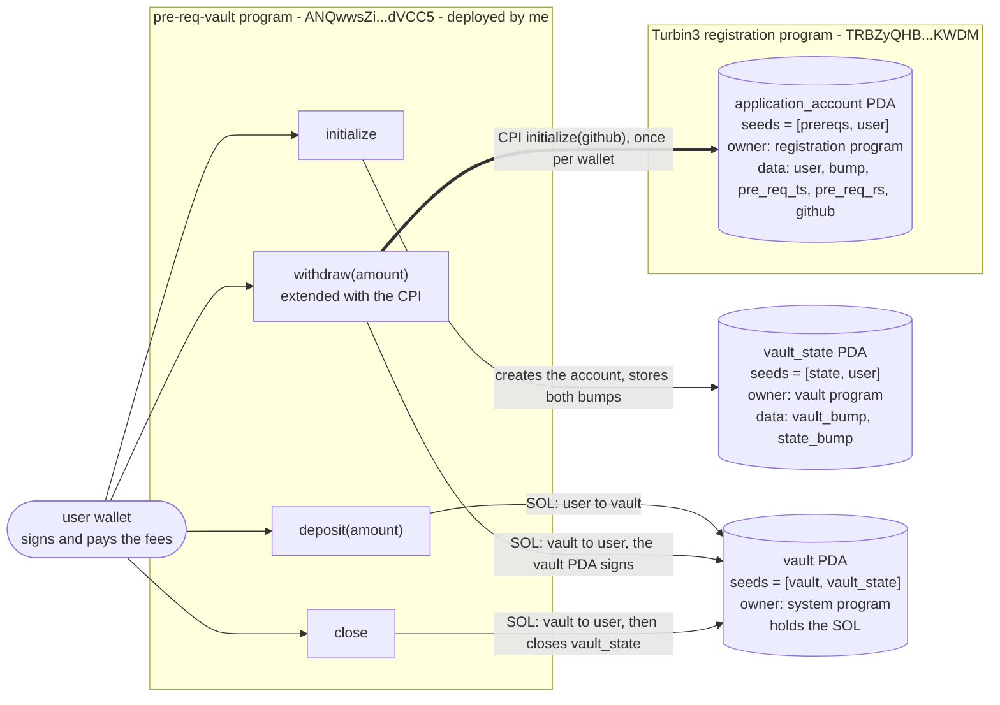
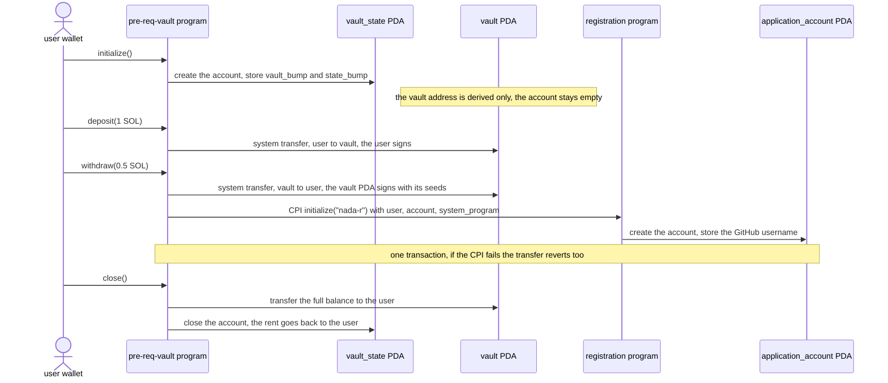

# Architecture

This page explains the vault program to an engineer who is new to the project.
It shows the accounts, the four instructions, the SOL flows, and the CPI that
the `withdraw` instruction makes to the Turbin3 registration program.

- Vault program (deployed by me): `ANQwwsZiNSYMxUPZaNxNT5PxubRzRgHkqTSUzBtdVCC5`
- Registration program (deployed by Turbin3): `TRBZyQHB3m68FGeVsqTK39Wm4xejadjVhP5MAZaKWDM`
- Cluster: devnet

## Accounts, instructions, and flows

## The withdraw path

## State after each test

| Test | vault_state | vault | application_account | user balance |
| --- | --- | --- | --- | --- |
| 1. initialize | created, both bumps stored | 0 SOL, address only | none | minus rent and fee |
| 2. deposit 1 SOL | unchanged | 1 SOL | none | minus 1 SOL and fee |
| 3. withdraw 0.5 SOL | unchanged | 0.5 SOL | created, `github = "nada-r"` | plus 0.5 SOL, minus the account rent and fee |
| 4. close | closed, rent refunded | 0 SOL | unchanged, stays on chain | plus 0.5 SOL, plus rent, minus fee |

## Why the CPI works without signer seeds

- The `user` account is a `Signer` of the outer transaction. Solana propagates
  that signature to every CPI that passes the same account.
- The registration program needs the user as the payer and the signer of the
  new `application_account`. The vault program therefore passes `user` as is.
- The vault program does not sign the CPI with a PDA. It only signs the SOL
  transfer, with the seeds `["vault", vault_state, vault_bump]`.
- The constraint `seeds = ["prereqs", user]` with
  `seeds::program = application_program` makes the vault program check the PDA
  before the call.
- `initialize` on the registration program uses `init`. It succeeds once per
  wallet. A second `withdraw` with the same wallet fails with "already in use".
